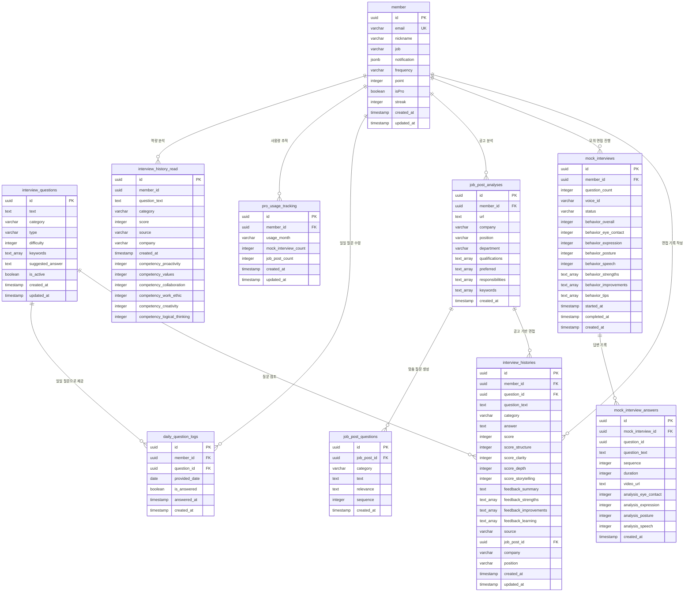

# Interview 도메인 상세 ERD

## Mermaid 다이어그램



---

## 텍스트 기반 상세 ERD

### Core Tables

```
┌─────────────────────────────────────────────────────────────┐
│                          member                              │
├─────────────────────────────────────────────────────────────┤
│ 🔑 id: UUID (PK)                                             │
│ 🔒 email: VARCHAR(255) UNIQUE NOT NULL                       │
│    nickname: VARCHAR(100) NOT NULL                           │
│    job: VARCHAR(100)                                         │
│    notification: JSONB                                       │
│    frequency: VARCHAR(20)                                    │
│    point: INTEGER DEFAULT 0                                  │
│    isPro: BOOLEAN DEFAULT false                              │
│    streak: INTEGER DEFAULT 0                                 │
│    created_at: TIMESTAMP                                     │
│    updated_at: TIMESTAMP                                     │
└────────────────┬────────────────────────────────────────────┘
                 │
                 │ 1:N
                 ├─────────────────────────────────────────────┐
                 │                                             │
                 ▼                                             ▼
┌─────────────────────────────────────────┐  ┌──────────────────────────────────┐
│      interview_questions                │  │   daily_question_logs            │
├─────────────────────────────────────────┤  ├──────────────────────────────────┤
│ 🔑 id: UUID (PK)                        │  │ 🔑 id: UUID (PK)                 │
│    text: TEXT NOT NULL                  │  │ 🔗 member_id: UUID (FK)          │
│    category: VARCHAR(50) NOT NULL       │  │ 🔗 question_id: UUID (FK)        │
│    type: VARCHAR(20) DEFAULT 'daily'    │  │ 🔒 provided_date: DATE (UNIQUE)  │
│    difficulty: INTEGER (1-5)            │  │    is_answered: BOOLEAN          │
│    keywords: TEXT[]                     │  │    answered_at: TIMESTAMP        │
│    suggested_answer: TEXT               │  │    created_at: TIMESTAMP         │
│    is_active: BOOLEAN                   │  └────────┬─────────────────────────┘
│    created_at: TIMESTAMP                │           │
│    updated_at: TIMESTAMP                │           │ N:1
└────────────┬────────────────────────────┘           │
             │                                         │
             │ 1:N                                     │
             ▼                                         ▼
┌───────────────────────────────────────────────────────────────────────┐
│                     interview_histories                                │
├───────────────────────────────────────────────────────────────────────┤
│ 🔑 id: UUID (PK)                                                       │
│ 🔗 member_id: UUID (FK) → member.id                                   │
│ 🔗 question_id: UUID (FK) → interview_questions.id                    │
│    question_text: TEXT NOT NULL (스냅샷)                               │
│    category: VARCHAR(50) NOT NULL                                     │
│    answer: TEXT NOT NULL                                              │
│                                                                        │
│    📊 score: INTEGER (0-100) NOT NULL                                 │
│    score_structure: INTEGER (0-100)                                   │
│    score_clarity: INTEGER (0-100)                                     │
│    score_depth: INTEGER (0-100)                                       │
│    score_storytelling: INTEGER (0-100)                                │
│                                                                        │
│    💬 feedback_summary: TEXT                                          │
│    feedback_strengths: TEXT[]                                         │
│    feedback_improvements: TEXT[]                                      │
│    feedback_learning: TEXT[]                                          │
│                                                                        │
│    source: VARCHAR(20) DEFAULT 'daily'  (daily | jobpost)             │
│ 🔗 job_post_id: UUID (FK) → job_post_analyses.id                      │
│    company: VARCHAR(255)                                              │
│    position: VARCHAR(255)                                             │
│                                                                        │
│    created_at: TIMESTAMP                                              │
│    updated_at: TIMESTAMP                                              │
│                                                                        │
│ 📑 INDEX: member_id, source, created_at DESC, company                │
└───────────────────────────────────────────────────────────────────────┘
                                  ▲
                                  │ N:1
                                  │
┌─────────────────────────────────┴─────────────────────────────────────┐
│                      job_post_analyses                                 │
├───────────────────────────────────────────────────────────────────────┤
│ 🔑 id: UUID (PK)                                                       │
│ 🔗 member_id: UUID (FK) → member.id                                   │
│    url: TEXT NOT NULL                                                 │
│    company: VARCHAR(255) NOT NULL                                     │
│    position: VARCHAR(255) NOT NULL                                    │
│    department: VARCHAR(255)                                           │
│                                                                        │
│    qualifications: TEXT[]  (자격요건)                                  │
│    preferred: TEXT[]       (우대사항)                                  │
│    responsibilities: TEXT[] (담당업무)                                 │
│    keywords: TEXT[]        (기술 키워드)                               │
│                                                                        │
│    created_at: TIMESTAMP                                              │
│                                                                        │
│ 📑 INDEX: member_id, company, created_at DESC                         │
└────────────────┬──────────────────────────────────────────────────────┘
                 │
                 │ 1:N
                 ▼
┌─────────────────────────────────────────┐
│       job_post_questions                │
├─────────────────────────────────────────┤
│ 🔑 id: UUID (PK)                        │
│ 🔗 job_post_id: UUID (FK)               │
│    category: VARCHAR(50) NOT NULL       │
│    text: TEXT NOT NULL                  │
│    relevance: TEXT NOT NULL             │
│    sequence: INTEGER NOT NULL           │
│    created_at: TIMESTAMP                │
│                                         │
│ 📑 INDEX: job_post_id                   │
└─────────────────────────────────────────┘
```

### Mock Interview Tables

```
┌───────────────────────────────────────────────────────────────────────┐
│                        mock_interviews                                 │
├───────────────────────────────────────────────────────────────────────┤
│ 🔑 id: UUID (PK)                                                       │
│ 🔗 member_id: UUID (FK) → member.id                                   │
│    question_count: INTEGER (1-10) NOT NULL                            │
│    voice_id: VARCHAR(50) NOT NULL                                     │
│    status: VARCHAR(20) DEFAULT 'ready'                                │
│           (ready | in_progress | completed | cancelled)               │
│                                                                        │
│    🎭 behavior_overall: INTEGER (0-100)                               │
│    behavior_eye_contact: INTEGER (0-100)                              │
│    behavior_expression: INTEGER (0-100)                               │
│    behavior_posture: INTEGER (0-100)                                  │
│    behavior_speech: INTEGER (0-100)                                   │
│    behavior_strengths: TEXT[]                                         │
│    behavior_improvements: TEXT[]                                      │
│    behavior_tips: TEXT[]                                              │
│                                                                        │
│    started_at: TIMESTAMP                                              │
│    completed_at: TIMESTAMP                                            │
│    created_at: TIMESTAMP                                              │
│                                                                        │
│ 📑 INDEX: member_id, status, created_at DESC                          │
└────────────────┬──────────────────────────────────────────────────────┘
                 │
                 │ 1:N
                 ▼
┌─────────────────────────────────────────────────────────────────┐
│                 mock_interview_answers                          │
├─────────────────────────────────────────────────────────────────┤
│ 🔑 id: UUID (PK)                                                │
│ 🔗 mock_interview_id: UUID (FK) → mock_interviews.id           │
│    question_id: UUID NOT NULL                                   │
│    question_text: TEXT NOT NULL                                 │
│    sequence: INTEGER NOT NULL                                   │
│    duration: INTEGER NOT NULL (초)                              │
│    video_url: TEXT                                              │
│                                                                 │
│    🎭 analysis_eye_contact: INTEGER (0-100)                    │
│    analysis_expression: INTEGER (0-100)                         │
│    analysis_posture: INTEGER (0-100)                            │
│    analysis_speech: INTEGER (0-100)                             │
│                                                                 │
│    created_at: TIMESTAMP                                        │
│                                                                 │
│ 🔒 UNIQUE: (mock_interview_id, sequence)                        │
│ 📑 INDEX: mock_interview_id                                     │
└─────────────────────────────────────────────────────────────────┘
```

### Tracking Tables

```
┌─────────────────────────────────────────┐
│       pro_usage_tracking                │
├─────────────────────────────────────────┤
│ 🔑 id: UUID (PK)                        │
│ 🔗 member_id: UUID (FK) → member.id     │
│ 🔒 usage_month: VARCHAR(7) (YYYY-MM)    │
│    mock_interview_count: INTEGER        │
│    job_post_count: INTEGER              │
│    created_at: TIMESTAMP                │
│    updated_at: TIMESTAMP                │
│                                         │
│ 🔒 UNIQUE: (member_id, usage_month)     │
└─────────────────────────────────────────┘
```

### Read Model (CQRS)

```
┌───────────────────────────────────────────────────────────────────────┐
│              interview_history_read (Read Model - CQRS)                │
├───────────────────────────────────────────────────────────────────────┤
│ 🔑 id: UUID (PK)                                                       │
│    member_id: UUID NOT NULL                                           │
│    question_text: TEXT NOT NULL                                       │
│    category: VARCHAR(50) NOT NULL                                     │
│    score: INTEGER NOT NULL                                            │
│    source: VARCHAR(20) NOT NULL                                       │
│    company: VARCHAR(255)                                              │
│    created_at: TIMESTAMP NOT NULL                                     │
│                                                                        │
│    📊 역량 분석 (육각형 차트)                                          │
│    competency_proactivity: INTEGER      (적극성)                      │
│    competency_values: INTEGER           (가치관)                      │
│    competency_collaboration: INTEGER    (협동성)                      │
│    competency_work_ethic: INTEGER       (성실성)                      │
│    competency_creativity: INTEGER       (창의력)                      │
│    competency_logical_thinking: INTEGER (논리력)                      │
│                                                                        │
│ 📑 INDEX: member_id, created_at DESC                                  │
└───────────────────────────────────────────────────────────────────────┘
```

---

## 범례

| 기호 | 의미 |
|------|------|
| 🔑 | Primary Key |
| 🔗 | Foreign Key |
| 🔒 | Unique Constraint |
| 📊 | Embedded Value Object (점수) |
| 💬 | Embedded Value Object (피드백) |
| 🎭 | Embedded Value Object (행동 분석) |
| 📑 | Index |

---

## 테이블 목록

| 테이블명 | 설명 | Aggregate Root |
|----------|------|----------------|
| `member` | 회원 정보 | Member (기존) |
| `interview_questions` | 면접 질문 마스터 | InterviewQuestion |
| `interview_histories` | 면접 기록 (일일/공고) | InterviewHistory |
| `job_post_analyses` | 채용 공고 분석 | JobPostAnalysis |
| `job_post_questions` | 공고 맞춤 질문 | - (JobPostAnalysis의 일부) |
| `mock_interviews` | 모의 면접 세션 | MockInterview |
| `mock_interview_answers` | 모의 면접 개별 답변 | - (MockInterview의 일부) |
| `daily_question_logs` | 일일 질문 제공 로그 | - |
| `pro_usage_tracking` | Pro 플랜 사용량 추적 | - |
| `interview_history_read` | 면접 기록 Read Model (CQRS) | - (Read Only) |

---

## 주요 관계

| 관계 | Cardinality | 설명 |
|------|-------------|------|
| `member` → `interview_histories` | 1:N | 회원이 여러 면접 기록을 가짐 |
| `member` → `mock_interviews` | 1:N | 회원이 여러 모의 면접을 진행 |
| `member` → `job_post_analyses` | 1:N | 회원이 여러 공고를 분석 |
| `member` → `daily_question_logs` | 1:N | 회원에게 매일 질문이 제공됨 |
| `member` → `pro_usage_tracking` | 1:N | 회원별 월별 사용량 추적 |
| `interview_questions` → `interview_histories` | 1:N | 질문이 여러 기록에서 사용됨 |
| `interview_questions` → `daily_question_logs` | 1:N | 질문이 일일 질문으로 제공됨 |
| `job_post_analyses` → `job_post_questions` | 1:N | 공고 분석당 여러 맞춤 질문 생성 |
| `job_post_analyses` → `interview_histories` | 1:N | 공고 기반 면접 기록 |
| `mock_interviews` → `mock_interview_answers` | 1:N | 모의 면접당 여러 답변 기록 |

---

## 중요 제약 조건

### Unique Constraints

1. `daily_question_logs(member_id, provided_date)` - 하루에 한 질문만
2. `pro_usage_tracking(member_id, usage_month)` - 월별 사용량 유일성
3. `mock_interview_answers(mock_interview_id, sequence)` - 질문 순서 유일성

### Check Constraints

1. `interview_questions.difficulty` - 1~5 범위
2. `interview_histories.score*` - 0~100 범위
3. `mock_interviews.behavior_*` - 0~100 범위
4. `mock_interviews.question_count` - 1~10 범위
5. `mock_interview_answers.analysis_*` - 0~100 범위

### Indexes

#### 성능 최적화 인덱스
- `interview_histories(member_id, created_at DESC)` - 회원별 최신 기록 조회
- `interview_histories(source)` - 출처별 필터링
- `interview_histories(company)` - 회사별 검색
- `mock_interviews(member_id, status)` - 진행 중인 면접 조회
- `job_post_analyses(member_id, company)` - 회원별 공고 검색

---

## Value Objects 매핑

### FeedbackScore & FeedbackBreakdown
```
interview_histories 테이블에 Embedded:
- score (overall)
- score_structure
- score_clarity
- score_depth
- score_storytelling
```

### AIFeedback
```
interview_histories 테이블에 Embedded:
- feedback_summary
- feedback_strengths (TEXT[])
- feedback_improvements (TEXT[])
- feedback_learning (TEXT[])
```

### BehaviorAnalysis
```
mock_interviews 테이블에 Embedded:
- behavior_overall
- behavior_eye_contact
- behavior_expression
- behavior_posture
- behavior_speech
- behavior_strengths (TEXT[])
- behavior_improvements (TEXT[])
- behavior_tips (TEXT[])
```

### JobRequirements
```
job_post_analyses 테이블에 Embedded:
- qualifications (TEXT[])
- preferred (TEXT[])
- responsibilities (TEXT[])
- keywords (TEXT[])
```

---

## CQRS Read Model 업데이트 트리거

### interview_history_read 업데이트 시점

```typescript
// InterviewCompletedEvent 발생 시
@EventsHandler(InterviewCompletedEvent)
export class UpdateInterviewHistoryReadModelHandler {
  async handle(event: InterviewCompletedEvent) {
    // 1. interview_history_read 테이블에 Insert
    // 2. 카테고리 기반 역량 점수 계산
    // 3. competency_* 필드 업데이트
  }
}
```

### 역량 점수 매핑 로직
- `experience` 카테고리 → `competency_proactivity`, `competency_work_ethic`
- `collaboration` 카테고리 → `competency_collaboration`
- `self-analysis` 카테고리 → `competency_values`
- `technical` 카테고리 → `competency_logical_thinking`
- `growth` 카테고리 → `competency_creativity`

---

## 마이그레이션 순서

1. `interview_questions` 테이블 생성
2. `job_post_analyses` 테이블 생성
3. `job_post_questions` 테이블 생성 (FK: job_post_analyses)
4. `interview_histories` 테이블 생성 (FK: member, interview_questions, job_post_analyses)
5. `mock_interviews` 테이블 생성 (FK: member)
6. `mock_interview_answers` 테이블 생성 (FK: mock_interviews)
7. `daily_question_logs` 테이블 생성 (FK: member, interview_questions)
8. `pro_usage_tracking` 테이블 생성 (FK: member)
9. `interview_history_read` 테이블 생성 (Read Model)

---

## 참고 사항

- 모든 테이블은 UUID를 Primary Key로 사용
- Soft Delete는 적용하지 않음 (Hard Delete)
- 타임스탬프는 UTC 기준
- TEXT[] 타입은 PostgreSQL 배열
- JSON 타입은 JSONB 사용 권장
